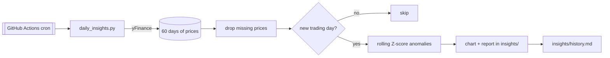

# Automated Daily Data Insights

[](https://github.com/Deshraj-Jogiya/automated-data-insights/actions/workflows/ci.yml) [](https://github.com/Deshraj-Jogiya/automated-data-insights/actions/workflows/daily_insights.yml) 

A daily market-data pipeline that runs entirely on GitHub Actions: it pulls S&P 500 ETF (SPY) prices from yFinance, flags unusual days
with a rolling Z-score, and commits a chart and a report for each new trading day, at no server cost.

## Highlights

- **Scheduled ETL:** `daily_insights.py` runs on a daily cron and fetches 60 days of prices with error handling.
- **Anomaly detection:** a daily return more than 2 standard deviations from its 20-day mean is flagged with its Z-score.
- **Trading days only:** reports are named after the last trading day in the data; a weekend or holiday run has no new close and is
  skipped instead of repeating Friday's numbers.
- **Clean inputs:** rows without a valid close price are dropped before analysis, so a gap in the feed can't reach a report.
- **Run history:** one row per trading day in [`insights/history.md`](insights/history.md), linking each day's report and chart.

## Architecture



## Stack

Python, yFinance, pandas, NumPy, Matplotlib, pytest, GitHub Actions.

## Run it

```bash
pip install -r requirements.txt
python daily_insights.py
python -m pytest tests/ -v
```
