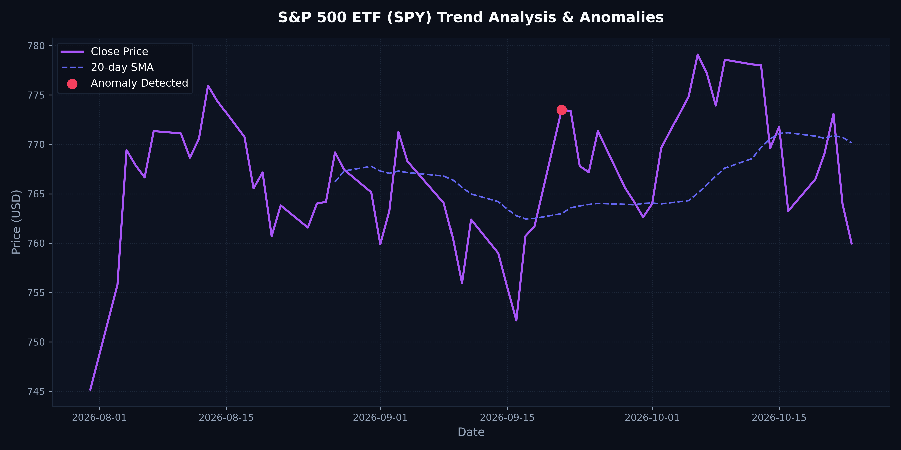

# Daily Market Anomaly Report

**Target Asset:** S&P 500 ETF (SPY)
**Trading Date:** 2026-10-23

Latest anomaly: 2026-09-21, daily return 1.55% (Z-score 2.22).

---

## Summary
* **Last Closing Price:** $759.97
* **Daily Percent Change:** -0.52%
* **Anomalies in the 60-day window:** 1

---

## Chart
Here is the trend visualization highlighting calculated moving averages and detected statistical outliers (Z-Score > 2.0):

---

## Anomalies in the last 60 days
| Date | Closing Price | Daily Return (%) | Outlier Z-Score |
|---|---|---|---|
| 2026-09-21 | $773.50 | +1.55% | 2.22 |

---
*Generated by automated daily workflow pipeline at 2026-10-23 20:47:12 UTC*
