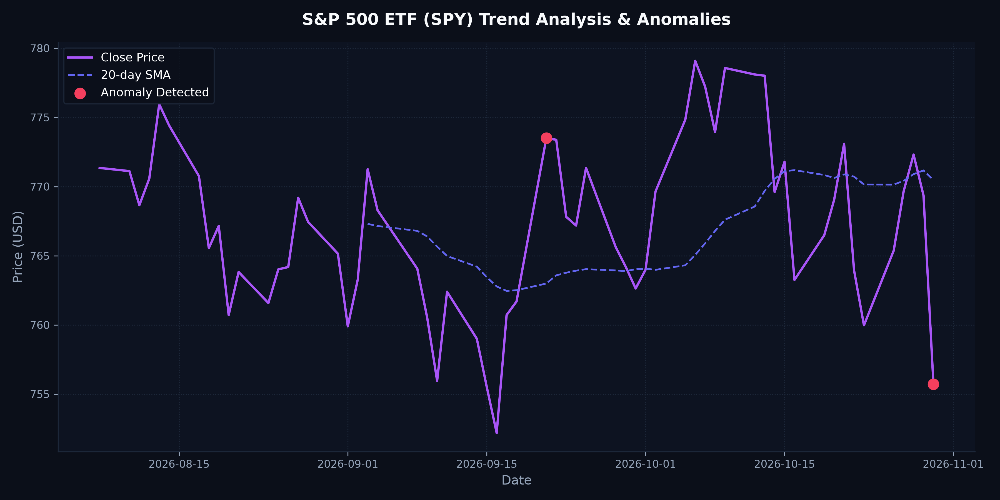

# Daily Market Anomaly Report

**Target Asset:** S&P 500 ETF (SPY)
**Trading Date:** 2026-10-30

Latest anomaly: 2026-10-30, daily return -1.77% (Z-score 2.31).

---

## Summary
* **Last Closing Price:** $755.72
* **Daily Percent Change:** -1.77%
* **Anomalies in the 60-day window:** 2

---

## Chart
Here is the trend visualization highlighting calculated moving averages and detected statistical outliers (Z-Score > 2.0):

---

## Anomalies in the last 60 days
| Date | Closing Price | Daily Return (%) | Outlier Z-Score |
|---|---|---|---|
| 2026-10-30 | $755.72 | -1.77% | 2.31 |
| 2026-09-21 | $773.50 | +1.55% | 2.22 |

---
*Generated by automated daily workflow pipeline at 2026-10-30 21:46:51 UTC*
